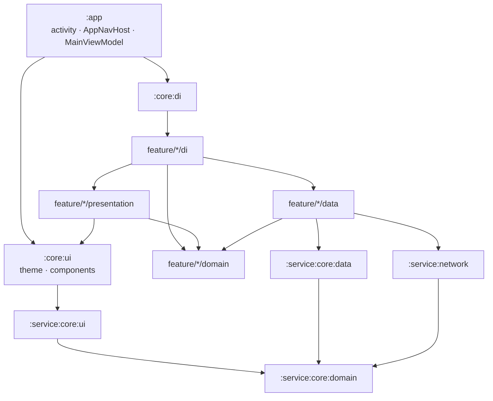
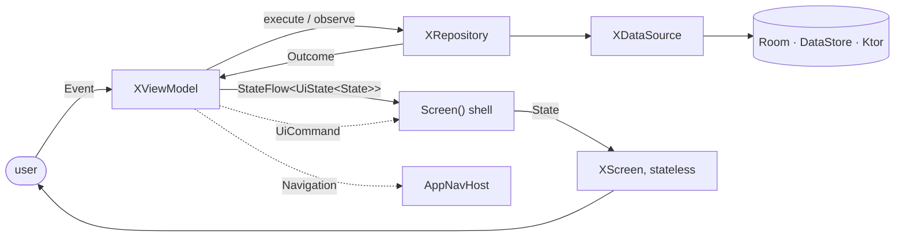
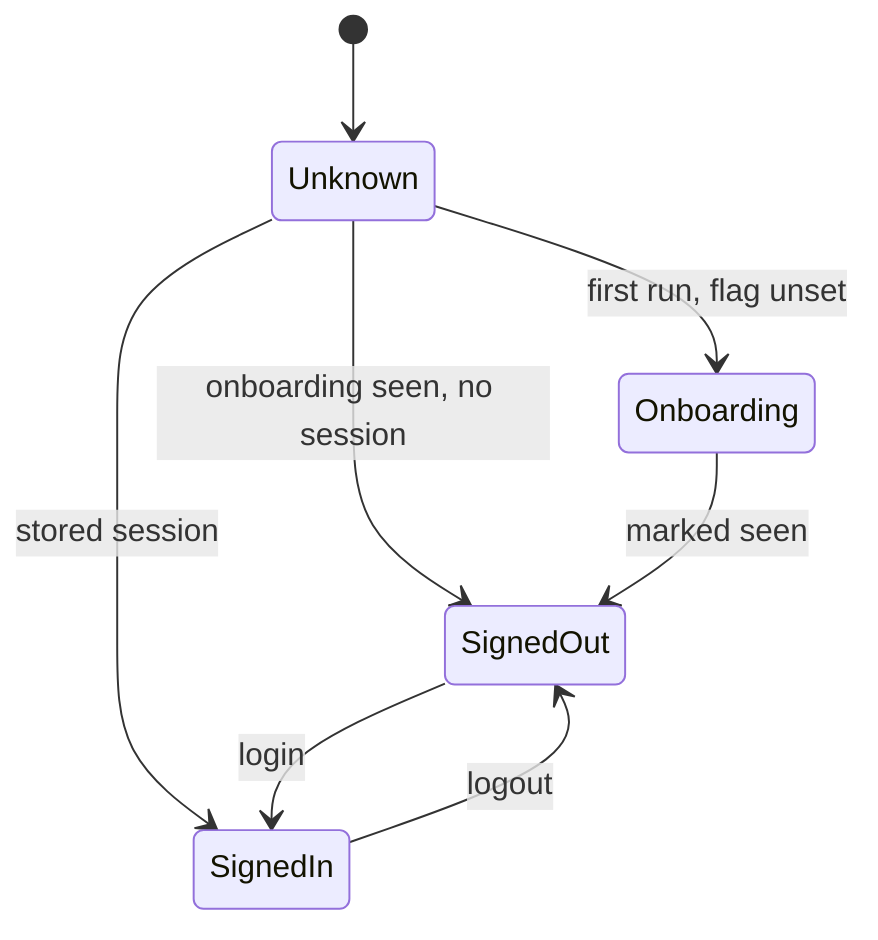

# Architecture

What the app is made of and how a value moves through it.

## Layers

Clean architecture over MVI, one activity, type-safe Compose navigation, Koin for injection.
Dependencies point one way only.

`service/` is the reusable half: it knows nothing about this app's features, theme or object graph,
and can be copied into another project directory-first. It therefore never references `:core:*`,
`:feature:*` or `:app`. `:service:core:domain` is a Kotlin/JVM module, so `android.*` is not on its
classpath and the compiler enforces the boundary.

A feature's `presentation` never depends on another feature's `presentation`. Crossing features is
pushing the other feature's route key, from its `api` module, through the `Navigator`; another
feature's `domain` is an ordinary dependency.

## A screen

Six files in a directory named after the screen, plus two tests. The route key is `@Serializable`
and is the whole argument-passing mechanism: a screen that takes arguments takes them in its
ViewModel's constructor.

`Screen()` is the only collector in the app and the only interpreter of one-off commands. It renders
the loading overlay, the alert dialog and the error and empty states centrally, so a feature screen
only ever receives a non-null state and never reimplements any of them. Navigation intents and
commands are buffered channels rather than shared flows, so one emitted while nothing is collecting
arrives on resume instead of being dropped.

Failures are values. A repository returns `Outcome`, a ViewModel calls it through `execute {}` or
`observe(flow = …) {}`, and those turn a failure into an alert or an inline retry and rethrow
cancellation. There is no `try`/`catch` in a ViewModel.

## Navigation

Navigation 3 with a back stack of plain `NavKey` route keys, remembered by `rememberNavBackStack` on
the first frame.

The five tabs do not own separate stacks. The one flat list **is** their concatenation in the order
the tabs were last visited: a tab's key starts a segment, selecting a tab moves that segment to the
end, and push and pop act on whichever segment is last. Per-tab history therefore survives process
death with no custom saver. Back on a tab's root goes Home, keeping Home's history and dropping the
rest; back on Home's root leaves the app. A second tap on the selected tab pops its segment to the
root and scrolls it to the top.

On a wide window, a list and its detail are shown side by side.

Returning a value from one screen to another goes through `NavResultStore`: Navigation 3 has no
previous-entry handle, and a stack of plain keys has nowhere to hang a value. The store is
remembered above the display so it outlives the screen being popped, and a result is consumed once.

## Session

`MainViewModel` owns the session and is the only thing that switches between flows. A screen changes
the session and lets it react; nothing navigates between the auth and main flows directly.

`Unknown` is what the splash screen holds; the back stack is composed unconditionally and the
display is gated instead. The session is stored in a DataStore encrypted with AES-GCM under an
Android Keystore key, and the network layer refreshes its tokens through a single-flight refresher.

## Data

Repositories sit over data sources: Ktor for the network, Room for what is cached or owned on the
device, DataStore for preferences and small records. A cached list is read from Room and refreshed
from the network, so it keeps showing when a refresh fails; the `inventory` sample goes further and
writes locally first, queueing each change in an outbox that WorkManager sends when there is a
network.

## Environments

Two build types and three flavors on one `environment` dimension, `dev`, `staging` and `prod`, so a
variant is named `devDebug` or `prodRelease`. `dev` and `staging` carry an application-id suffix and
their own launcher label, so all three install side by side. `BuildConfig.BASE_URL` differs per
flavor and no screen ever writes a URL. `dev` serves the catalog, the movies and the weather from
Ktor `MockEngine` fixtures; the debug menu can switch the public APIs to their real hosts, and can
make the fixtures slow, failing or offline.

The `debug` build type adds a network security config that trusts user certificates, so a debug
build can be proxied through Charles or mitmproxy, and StrictMode policies that log a main-thread
disk read the first time it happens. `release` runs R8 and has neither.

A release is a tag: `versionName` is the tag without its `v`, `versionCode` is the commit count. The
flavors, the SDK levels and the Java target are defined once, in `build-logic`'s `ProjectConfig`.

## Build logic

`build-logic/` is an included build holding the `convention.*` plugins every module applies:
library dependencies live in the plugin, project dependencies stay in the module. The namespace is
derived from the project path and `basePackage` in `gradle.properties`, so renaming the project
rewrites one property. `scripts/doctor.py` fails if a module build file sets SDK levels, compile
options or lint, names a library, or crosses a layer boundary.
